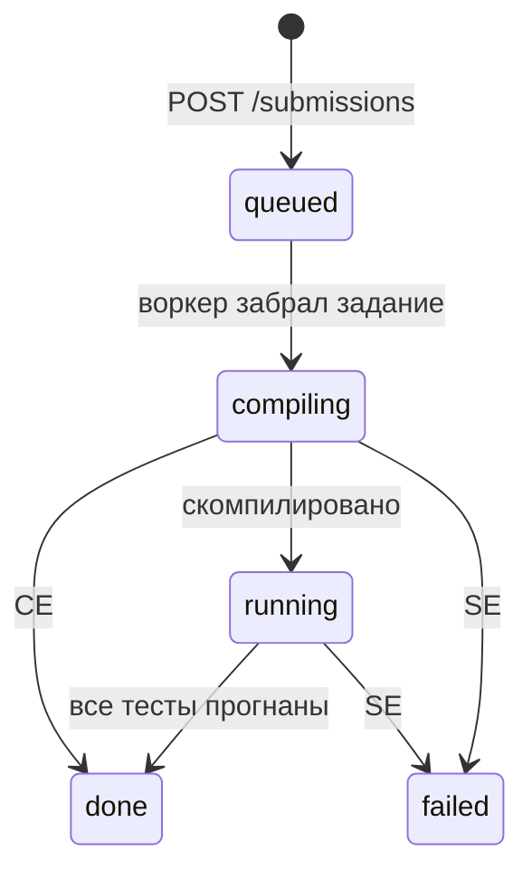
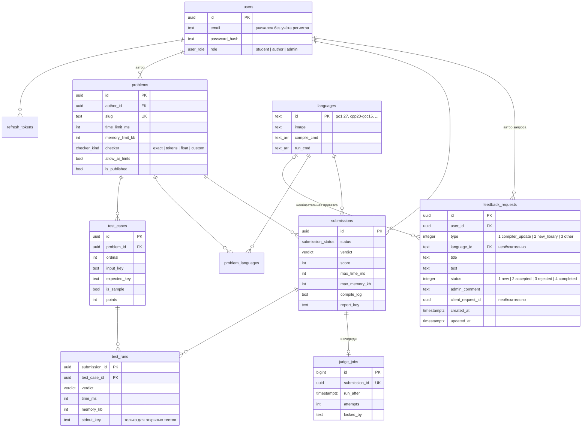

# База данных и жизненный цикл посылки

Общая архитектура системы: [infra/docs/architecture.md](https://github.com/autocheck-team/infra/blob/main/docs/architecture.md).

## Жизненный цикл посылки

`failed` означает сбой самой системы (вердикт `SE`), а не ошибку студента. Такую посылку
можно перепроверить. Ограничение в БД гарантирует, что у посылок в статусах `done` и
`failed` вердикт всегда заполнен.

Вердикты: `OK`, `CE` — ошибка компиляции, `WA` — неверный ответ, `TL` — превышено время,
`ML` — превышена память, `RE` — ошибка выполнения, `SE` — сбой системы.

## Схема БД

Миграции: [`internal/db/migrations`](../internal/db/migrations).

Таблицы для платных функций (тарифы, подписки, счётчики лимитов) и ИИ-функций появятся
в своих задачах (HPRPR-12 и далее) отдельными миграциями.

## Запросы пользователей

Миграция `00008_feedback_requests.sql` добавляет `feedback_requests`. Тип и статус
хранятся как `integer` с CHECK-ограничениями; `UNSPECIFIED = 0` не сохраняется.
Автор ссылается на `users`, необязательный язык — на `languages`, включая неактивные.
БД ограничивает длины заголовка (1–200), текста (1–10000) и комментария (0–5000)
в символах. Сервис дополнительно отвергает заголовок и текст только из пробелов.

Уникальный частичный индекс `(user_id, client_request_id)` предотвращает дубликаты
даже при параллельной отправке; NULL позволяет отправлять запросы без ключа.
Индексы по `(user_id, id DESC)`, `(status, id DESC)`, `(type, id DESC)`,
`(status, type, id DESC)` и сочетаниям пользователя со статусом и/или типом
поддерживают все варианты списков. Общий список использует первичный ключ.
Keyset-пагинация сравнивает UUIDv7 (`id < cursor`); `updated_at` не влияет на порядок.

Начальный статус — `new`. Сервис разрешает `new → accepted | rejected`,
`accepted → completed | rejected` и повтор текущего статуса для правки комментария.
Условный UPDATE сверяет прочитанный статус: параллельное изменение не может
обойти проверку перехода. Статус, комментарий и `updated_at` обновляются атомарно,
`created_at` сохраняется. Автор и содержимое запроса после создания неизменяемы.
Обратная миграция 00008 не удаляет пользовательские запросы: секция Down пуста.

## Очередь и результаты проверки

Миграция `00006_judge_pipeline.sql` добавляет `cpu_time_ms` в `test_runs`,
`stop_on_first_failure` и `checker_ready` в `problems`, `compile_env` в `languages`.
Индекс очереди полный: частичный индекс только по `locked_by IS NULL` не покрывал
бы просроченные аренды. Claim увеличивает attempts и получает аренду на 60 секунд;
каждая запись проверяет владельца, номер попытки и срок аренды под блокировкой
строки задания. Поэтому упавший или потерявший аренду воркер не перезапишет результат.

Новая попытка очищает `test_runs`; отдельные результаты записываются через upsert.
После трёх системных ошибок задание остаётся для диагностики с `last_error` и
`run_after = infinity`, посылка получает `failed / SE`. При успехе задание удаляется
в одной транзакции с итогом посылки. При SIGTERM аренда снимается, attempts уменьшается.
