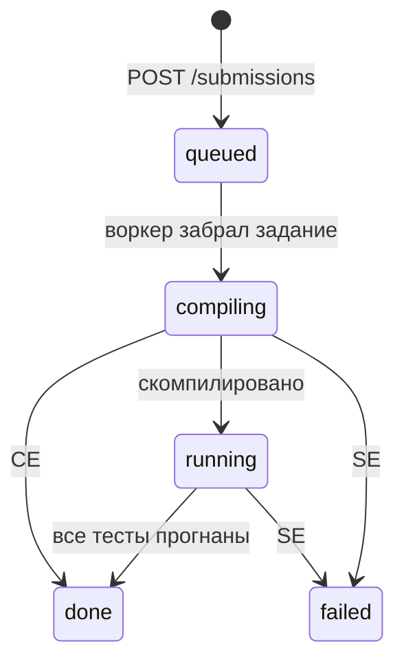
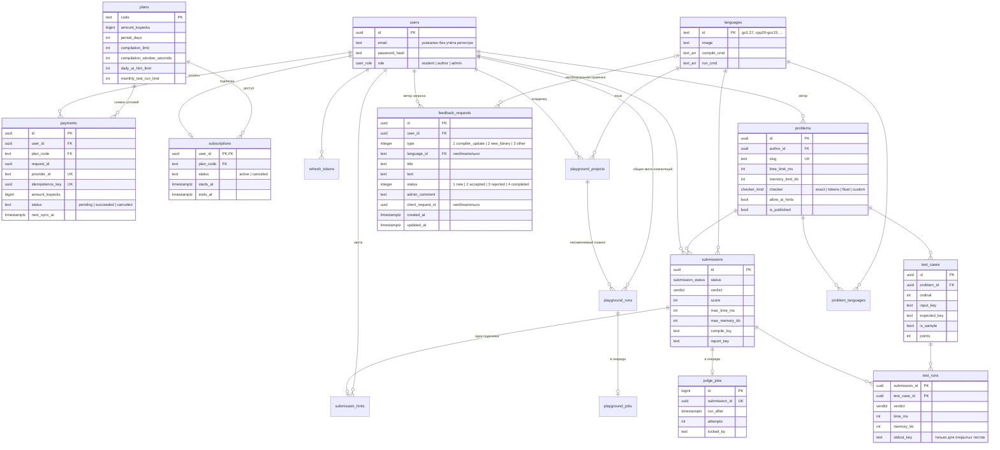

# База данных и жизненный цикл посылки

Общая архитектура системы: [infra/docs/architecture.md](https://github.com/autocheck-team/infra/blob/main/docs/architecture.md).

## Жизненный цикл посылки

`failed` означает сбой самой системы (вердикт `SE`), а не ошибку студента. Такую посылку
можно перепроверить. Ограничение в БД гарантирует, что у посылок в статусах `done` и
`failed` вердикт всегда заполнен.

Вердикты: `OK`, `CE` — ошибка компиляции, `WA` — неверный ответ, `TL` — превышено время,
`ML` — превышена память, `RE` — ошибка выполнения, `SE` — сбой системы.

## Схема БД

Миграции: [`internal/db/migrations`](../internal/db/migrations).

Тарифы и подписки добавлены миграцией `00009_billing.sql`; генерация тестов —
`00012_test_generations.sql`, подбор заданий — `00013_problem_recommendations.sql`.

## Подбор заданий

Миграция `00013_problem_recommendations.sql` только добавляет таблицы, существующие
задания и контракты их редактирования не меняет. Обратная миграция запрещена.

- `problem_embeddings`: `problem_id uuid` (PK, FK → `problems`, каскадное удаление),
  `content_hash text` (SHA-256 от `title + "\n" + statement`, 64 hex-символа),
  `model text`, nullable `embedding real[]` (`float4[]`, непустой одномерный вектор
  без NULL-элементов), `lease_token uuid`, `lease_until timestamptz`, `created_at`
  и `updated_at`. Нулевые, нечисловые и не помещающиеся в float4 векторы от модели
  отвергаются в Go. pgvector и специальные образы Postgres не нужны.
- `recommendation_usage`: составной PK `(user_id, usage_on)`, FK → `users`
  с каскадным удалением, положительный `requests integer`, `created_at`, `updated_at`.
  `usage_on` — календарная дата UTC; индекс по дате позволяет в дальнейшем
  удалять старые счётчики согласно политике хранения. Учебные цели не сохраняются.

Атомарный `INSERT ... ON CONFLICT ... WHERE requests < limit` резервирует запрос
до обращения к провайдеру. Исчерпанная квота не увеличивается, полночь UTC
создаёт новую строку; тариф в проверке не участвует.

Фоновый процесс API читает только опубликованные задания, сравнивает хэш и модель
и атомарно арендует изменённые строки. Внешний вызов не держит транзакцию или
блокировку соединения БД. Сохранение проверяет токен аренды и точное совпадение
исходного заголовка/условия с текущими; снятое с публикации задание не обновляется.
Сбой восстанавливается после истечения аренды. При подборе хэш и модель ещё раз
сверяются с текущим заданием; любой отсутствующий/устаревший вектор в подходящем
каталоге включает резервный поиск, чтобы новые задания не исчезали из выдачи.

Резервный поиск использует `to_tsvector`/`plainto_tsquery` с конфигурацией `russian`
по отдельным словам цели, ранжирование `ts_rank_cd`, строгую фильтрацию публикации
и активного языка. При малом каталоге отдельный поисковый индекс не требуется.
Перед ответом, в том числе после chat-запроса, публикация и язык перепроверяются.

## Запросы пользователей

Миграция `00008_feedback_requests.sql` добавляет `feedback_requests`. Тип и статус
хранятся как `integer` с CHECK-ограничениями; `UNSPECIFIED = 0` не сохраняется.
Автор ссылается на `users`, необязательный язык — на `languages`, включая неактивные.
БД ограничивает длины заголовка (1–200), текста (1–10000) и комментария (0–5000)
в символах. Сервис дополнительно отвергает заголовок и текст только из пробелов.

Уникальный частичный индекс `(user_id, client_request_id)` предотвращает дубликаты
даже при параллельной отправке; NULL позволяет отправлять запросы без ключа.
Индексы по `(user_id, id DESC)`, `(status, id DESC)`, `(type, id DESC)`,
`(status, type, id DESC)` и сочетаниям пользователя со статусом и/или типом
поддерживают все варианты списков. Общий список использует первичный ключ.
Keyset-пагинация сравнивает UUIDv7 (`id < cursor`); `updated_at` не влияет на порядок.

Начальный статус — `new`. Сервис разрешает `new → accepted | rejected`,
`accepted → completed | rejected` и повтор текущего статуса для правки комментария.
Условный UPDATE сверяет прочитанный статус: параллельное изменение не может
обойти проверку перехода. Статус, комментарий и `updated_at` обновляются атомарно,
`created_at` сохраняется. Автор и содержимое запроса после создания неизменяемы.
Обратная миграция 00008 не удаляет пользовательские запросы: секция Down пуста.

## Очередь и результаты проверки

Миграция `00006_judge_pipeline.sql` добавляет `cpu_time_ms` в `test_runs`,
`stop_on_first_failure` и `checker_ready` в `problems`, `compile_env` в `languages`.
Индекс очереди полный: частичный индекс только по `locked_by IS NULL` не покрывал
бы просроченные аренды. Claim увеличивает attempts и получает аренду на 60 секунд;
каждая запись проверяет владельца, номер попытки и срок аренды под блокировкой
строки задания. Поэтому упавший или потерявший аренду воркер не перезапишет результат.

Новая попытка очищает `test_runs`; отдельные результаты записываются через upsert.
После трёх системных ошибок задание остаётся для диагностики с `last_error` и
`run_after = infinity`, посылка получает `failed / SE`. При успехе задание удаляется
в одной транзакции с итогом посылки. При SIGTERM аренда снимается, attempts уменьшается.

## Уведомления и отчёт (HPRPR-25, HPRPR-26)

Схема не меняется, миграция `00007` не требуется. В транзакциях `Start`, `Running`,
`SaveTest`, `Finish`, `Fail`, `Release` воркер выполняет
`SELECT pg_notify('submission_events', '<submission UUID>')`. Сигнал доступен только
после commit и не содержит результатов или тестовых данных. Rollback отменяет и сигнал.

API держит одно отдельное от пула соединение с `LISTEN submission_events`.
По UUID перечитывает состояние, а после переподключения будит все локальные подписки.
NOTIFY может объединять события и не хранит историю: дополнительная сверка раз в
30 секунд восстанавливает текущее состояние при пропуске последнего сигнала.
Медленные клиенты не задерживают LISTEN и других подписчиков.

Отчёт читает `submissions.language_id/verdict/score/compile_log`, результаты
`test_runs` и признаки `test_cases.is_sample`. Для открытого теста с WA вход/эталон
читаются из S3 по `input_key/expected_key`, фактический вывод — по `stdout_key`.
Воркер уже сохраняет stdout только открытых тестов. Закрытые ключи не возвращаются
запросом результатов; дополнительно раскрытие запрещено при сборке отчёта.
`stdout_key IS NULL` у старого прогона означает отсутствие артефакта, а не пустой stdout.
Каждый показываемый файл ограничен 4 КиБ, diff строится по этим префиксам.
`report_key` остаётся резервом для экспортированных артефактов, JSON собирается по запросу.

## Биллинг и квоты (00009)

- `plans`: код (`free` / `pro`), название, цена `amount_kopecks bigint`, срок в днях,
  число компиляций, окно в секундах и месячный лимит прогонов. Нулевой лимит означает
  отсутствие ограничения. Free: 1 / 60 секунд и 100 прогонов; Pro: 29900 копеек / 30 дней.
- `subscriptions`: одна строка на пользователя, план, `active` / `canceled`,
  `starts_at` / `ends_at`. Просроченная или отсутствующая подписка даёт эффективный free;
  дата окончания проверяется при чтении, отдельный cron для истечения не нужен.
- `payments`: наш UUID, владелец, тариф, UUID запроса, уникальные `provider_id`
  и `idempotence_key`, снимок суммы/длительности, URL возврата и подтверждения,
  `pending` / `succeeded` / `canceled`, время следующей сверки. Пара `(user_id, request_id)`
  уникальна, чтобы клиентский повтор не создал новую покупку. Строка создаётся **до** API ЮKassa.
- `test_runs.created_at`: календарный месяц UTC по времени записи результата;
  индекс `(created_at, submission_id)` поддерживает подсчёт расхода. У старых результатов
  дата восстанавливается из `finished_at` / `started_at` / `created_at` посылки,
  чтобы история целиком не попала в месяц применения миграции.
- `submissions.test_run_budget`: число готовых тестов при приёме посылки. Активная
  очередь резервирует `max(budget - число сохранённых результатов, 0)` прогонов,
  чтобы параллельные отправки не обходили квоту. Завершённые `done` / `failed`
  посылки резерв не удерживают. Результаты предыдущей попытки воркер по-прежнему
  очищает; квота считает сохранённые `test_runs`, а не системные повторы проверки.

Операция приёма посылки блокирует строку `users FOR UPDATE`, проверяет прежний
`client_request_id`, выбирает эффективный тариф, считает компилируемые посылки
в скользящем окне и месячные прогоны с резервом; затем вставляет посылку и `judge_jobs`
в той же транзакции. Источником расхода остаётся БД, локальных счётчиков API нет.

Подтверждение оплаты блокирует `payments FOR UPDATE`, проверяет ответ API ЮKassa
и в одной транзакции переводит pending в succeeded и изменяет подписку.
Повторный webhook или фоновой GET не добавляет период ещё раз. Разные успешные
оплаты пользователя сериализуются через `users FOR UPDATE` и продлевают доступ
от `max(текущее окончание, now())`. Цена и длительность берутся из снимка покупки,
поэтому редактирование каталога не меняет уже оплаченные условия.

Фоновая сверка в процессе API берёт до 50 pending-платежей через `FOR UPDATE SKIP LOCKED`,
переносит `next_sync_at` на 30 секунд и читает провайдера вне транзакции.
Ошибка одного платежа не блокирует остальные. Для потерянного ответа создания POST
повторяется с сохранённым ключом в пределах 23 часов; более старое неопределённое
создание остаётся pending для ручной сверки, без риска повторного списания.
Миграция 00009 выполняется только вперёд, Down содержит поясняющий комментарий.

## Наблюдение очереди (HPRPR-15)

Схема и миграции не меняются. Worker раз в `METRICS_POLL_INTERVAL` (5s) читает
глобальный снимок `judge_jobs JOIN submissions` обычным SELECT без захвата аренд
и блокировки строк. Запрос ограничен `METRICS_QUERY_TIMEOUT` (3s).

- `waiting`: незавершённые посылки без действующей аренды, включая отложенные
  повторы (`run_after` в будущем) и истёкшие аренды.
- `running`: незавершённые посылки с `locked_by` и `locked_until > now()`.
- `done` и `failed` исключены, в том числе SE с оставшейся строкой `judge_jobs`.

Снимок экспортируется как `autocheck_judge_queue_depth{state}`; несколько worker
видят одну БД, поэтому в Prometheus используется max по процессам, а не сумма.
Scrape читает готовые gauges и не обращается в PostgreSQL. При ошибке опроса gauges
сохраняют последний снимок, а метрики успешности и времени обновления показывают сбой.
Счётчики платежей увеличиваются после commit новых строк и перехода в succeeded;
повтор checkout/webhook не создаёт дополнительное событие метрики.

## Учебные материалы (00010)

Миграция `00010_materials.sql` выполняется только вперёд. Добавляет
`plans.has_material_access boolean NOT NULL DEFAULT false`; для `pro` выставляется
`true`, для `free` остаётся `false`. Эффективный флаг читается через billing вместе
со сроком и состоянием подписки; отменённая, истёкшая или будущая подписка даёт free.

- `materials`: UUIDv7 `id`, уникальный UUID операции `request_id`, `title` (1–200),
  `description` (до 2000), `content_markdown` (1–200000), неотрицательный `ordinal`,
  `is_published`, `created_at`/`updated_at timestamptz`. Создание идемпотентно:
  конфликт `request_id` возвращает первоначальный материал, не меняя его связи.
- `material_problems`: составной PK `(material_id, problem_id)`; связи заменяются
  одной транзакцией вместе с полями материала. Сервис требует 1–100 различных заданий;
  FK защищает существование заданий, ошибка откатывает всю замену. Перед удалением
  связанного задания нужно убрать его из материалов либо удалить эти материалы;
  удаление задания не должно оставлять опубликованный материал без привязок.
- `material_attachments`: UUIDv7 `id`, `material_id`, UUID `request_id`, `filename`,
  закрытый `object_key`, `content_type`, `size_bytes bigint`, `is_ready`, даты.
  UNIQUE `(material_id, request_id)` разрешает повтор создания. Каскадное удаление
  материала удаляет связи и метаданные вложений; файлы S3 удаляются после фиксации БД.
  DELETE API идемпотентны, поэтому очистку можно повторить после сбоя S3.

Индексы `(ordinal,id)` и частичный `(ordinal,id) WHERE is_published` поддерживают
общие списки admin и остальных пользователей. Обратный индекс
`material_problems(problem_id,material_id)` покрывает фильтр задания; индекс
`material_attachments(material_id,id)` — выборку вложений. Пагинация сравнивает
`(ordinal,id) > (cursor_ordinal,cursor_id)`; время правки не является курсором.
Токен содержит также фильтр задания и область видимости, смена их требует нового списка.
Списки не выбирают Markdown из БД; вложения запрашиваются только при платном доступе
или роли admin. Черновик для остальных возвращается как отсутствующий.

Сначала S3 PUT пишет в `materials/{id}/attachments/{attachment_id}/upload`.
Confirm ограниченно читает и проверяет файл, сохраняет его в новый закрытый ключ
`confirmed/{uuid}`, затем атомарно фиксирует первую успешную копию и её метаданные.
Параллельный confirm не меняет уже выбранный ключ; невыбранная копия удаляется.
Неуспешные операции могут оставить лишние объекты при недоступном S3, но не выдают
непроверенные файлы. Повторный PUT не способен заменить подтверждённое содержимое.

## Личное пространство и очередь запусков (00011)

Миграция `00011_playground.sql` добавляет три таблицы:

- `playground_projects`: UUIDv7 `id`, `user_id`, `title`, `language_id`, набор
  текстовых `files jsonb`, обязательный `client_request_id`, `created_at`,
  `updated_at`, `deleted_at`. Уникальность `(user_id, client_request_id)` действует
  и после удаления. Частичный индекс `(user_id, id DESC) WHERE deleted_at IS NULL`
  обслуживает список и подсчёт активных проектов. Мягкое удаление освобождает место
  в пространстве и сохраняет ссылки из запусков. Лимит 20 проектов проверяется
  под `users FOR UPDATE`; сервис проверяет размер в байтах, число и безопасные имена
  файлов, репозиторий дополнительно проверяет наличие source_file активного языка.
- `playground_runs`: UUIDv7, проект, владелец, язык, снимок доверенных команд языка
  `language jsonb`, `is_compiled`, файлы и stdin, ключ идемпотентности, статус
  `integer` (1 queued, 2 compiling, 3 running, 4 done, 5 failed), вердикт,
  код возврата, ограниченный вывод, время/память и даты создания/изменения.
  CHECK требует вердикт ровно в конечных состояниях. `is_compiled` фиксируется
  при приёме, поэтому редактирование проекта или каталога не меняет уже учтённый
  расход. Индекс `(user_id, created_at) WHERE is_compiled` обслуживает billing.
  Запуски, результаты и квота сохраняются при удалении проекта.
- `playground_jobs`: identity `bigint` PK, уникальный `run_id`, attempts,
  locked_by, locked_until, run_after, created_at, updated_at. Индекс
  `(run_after, id)` включает арендованные строки, чтобы находить просроченные аренды.

Приём запуска блокирует `users FOR UPDATE`, ищет прежний ключ до проверки квоты,
блокирует свой активный проект `FOR SHARE` и сохраняет снимок файлов/команд.
Проверка `billing.CheckCompilation` использует тот же `billing.Snapshot`, что
посылки: расход — UNION ALL компилируемых submissions и playground_runs в окне
эффективного тарифа. Вставка запуска и задания атомарна. Одновременная отправка
посылки и проекта сериализуется блокировкой одного пользователя. При повторе
ключа другого проекта возвращается конфликт; новый запуск удалённого проекта невозможен.
Месячная квота test_runs не расходуется и не резервируется.

Claim использует `FOR UPDATE SKIP LOCKED`, увеличивает attempts и выдаёт аренду 60s.
Heartbeat 20s, смена этапа, результат и повтор сверяют job id, run id, locked_by,
attempts и действующий locked_until под блокировкой строки. Поэтому результат
просроченной попытки не перезапишет новый. Результат фиксируется вместе с удалением
jobs; системный сбой после трёх попыток даёт failed/SE и тоже удаляет задание.
При штатной остановке attempts уменьшается, запуск возвращается в queued.
Промежуточные ошибки обрабатывает worker, исходные внутренние ошибки в API не раскрываются.
Миграция только вперёд, секция Down содержит запрет обратных миграций.

## Генерации тестов (00012, HPRPR-10)

- `plans.daily_test_generation_limit integer NOT NULL`: 0 запрещает генерации;
  исходные значения free=0, pro=10. Поле также возвращается в API тарифов.
- `test_cases.is_generated boolean NOT NULL DEFAULT false`: происхождение теста,
  выставляется только при явном принятии черновика. Старые тесты остаются false.
- `test_generations`: UUIDv7 `id`, `problem_id`, `user_id`, `request_id`, `task jsonb`
  со снимком условия/эталона/лимитов/тулчейна, `status integer` (1 queued, 2 running,
  3 done, 4 failed), безопасная `error`, `lease_token`, `lease_until`, `attempts`,
  `created_at`, `updated_at`. Уникальность `(user_id, request_id)` обеспечивает
  идемпотентность. Индексы по `(user_id, created_at)` для дневной квоты, `problem_id`
  для каскадной очистки и частичный индекс очереди `(status, lease_until, id)`.
- `generated_tests`: UUIDv7 `id`, `generation_id`, `ordinal`, `input/expected bytea`
  (CHECK ≤1 МиБ каждое), `explanation`, `rejection_reason`, `is_accepted`,
  `created_at`, `updated_at`. Уникальность `(generation_id, ordinal)`.

Владение и Pro проверяются до постановки, квота — в транзакции под тем же
`users FOR UPDATE`, что и приём посылок/активация подписки. Считаются все генерации
за текущие сутки UTC, включая queued/failed. Повтор request_id не резервирует квоту.
Запрос с тем же request_id для другого задания отклоняется.

Очередь отделена от `judge_jobs`: heartbeat 20s, аренда 60s, токен поколения
защищает запись черновиков от старого воркера. Черновики и конечный статус
записываются одной транзакцией; поле `Source` удаляется из task после завершения.
Черновики не связаны с проверкой посылок до accept. При принятии UUID черновика
становится UUID test_case, ordinal назначается под `problems FOR UPDATE`, файлы
уже загружены в S3 по стабильным ключам. Вся выборка принимается атомарно;
повтор не создаёт дубликатов, удаление принятого теста не воскрешает его при replay.
Удаление задания каскадно удаляет генерации и черновики. Срок хранения черновиков
пока ограничен только жизненным циклом задания; самостоятельной TTL-очистки нет.

Миграция только вперёд; секция Down не содержит обратных операций.

## Подсказки к посылкам (00014, HPRPR-6)

Миграция `00014_submission_hints.sql` сохраняет существующий `allow_ai_hints`:
поле уже было в 00001, `ADD COLUMN IF NOT EXISTS` оставляет значения автора без изменений.
По умолчанию подсказки запрещены. `UpdateProblem` использует существующую маску
`allow_ai_hints`. `plans.daily_ai_hint_limit integer NOT NULL` ограничен CHECK >=0;
free=0, pro=20. Ноль запрещает подсказки, поле возвращается в каталоге и текущем тарифе.

`submission_hints` содержит `id bigint GENERATED ALWAYS AS IDENTITY`, уникальный
`submission_id`, `user_id`, проверенный `text` до 1000 символов, `is_fallback`,
`lease_token`, `lease_until`, `reserved_at`, `created_at`, `updated_at` (timestamptz).
CHECK состояния разрешает либо пустой текст с арендой, либо непустой текст без аренды.
В API время готовой подсказки берётся из `updated_at`. Исходник и промпт не сохраняются.
FK каскадно очищают историю при удалении посылки/пользователя.

Короткая транзакция блокирует `users FOR UPDATE`, затем проверяет флаг задания,
существующий ответ/резерв и активную Pro через `billing.Snapshot`. Дневная квота
считает готовые ответы и живые резервы с `reserved_at >= начало суток UTC`.
Индекс `(user_id, reserved_at)` поддерживает этот запрос, UNIQUE `(submission_id)`
— идемпотентное чтение и единственный резерв. Квота принадлежит владельцу посылки.

После commit сценарий читает S3 и вызывает LLM. Запись результата сверяет токен
и срок аренды, поэтому просроченный вызов не перезаписывает новый ответ. При ошибке
удаляется только собственный резерв; отмена клиента не отменяет очистку. После сбоя
процесса резерв можно перехватить по окончании аренды с новым токеном и временем
`reserved_at`, повторно проверив тариф и квоту. Готовый ответ бессрочно возвращается
без новых расходов; независимой TTL-очистки истории нет. Резерв до полуночи учитывается
в дне его создания, даже если ответ завершился после полуночи.

Миграция только вперёд: Down содержит «Обратные миграции запрещены.».

## Изолированные E2E-фикстуры (HPRPR-14)

Сквозные тесты не добавляют таблиц или административных методов в рабочий API.
`test/integration/driver.Pro` через отдельное соединение создаёт/обновляет строку
`subscriptions` только в одноразовой Compose-БД: активный `pro`, начало сейчас,
окончание через 30 дней. Тест подтверждает эффективный тариф через REST.

Для проверки месячной квоты создаются собственное задание, завершённая историческая
посылка и 100 результатов `test_runs` текущего месяца. Сами квоты `plans` не меняются;
REST должен показать расход 100 и отказ 429. Остальные задания, посылки, тесты,
материалы, feedback и проекты создаются через REST, файлы — через presigned S3 PUT.
Учётные записи и объекты уникальны. После прогона `down -v` удаляет БД, Keycloak
и S3 целиком; эти фикстуры нельзя запускать против постоянного стенда.
