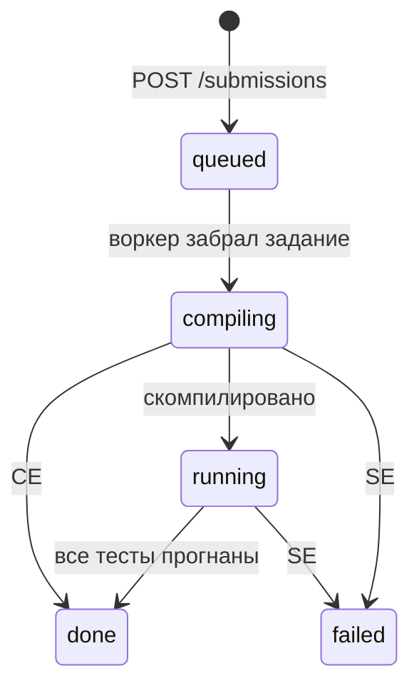
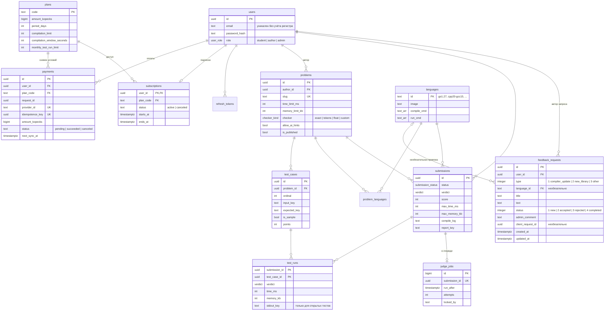

# База данных и жизненный цикл посылки

Общая архитектура системы: [infra/docs/architecture.md](https://github.com/autocheck-team/infra/blob/main/docs/architecture.md).

## Жизненный цикл посылки

`failed` означает сбой самой системы (вердикт `SE`), а не ошибку студента. Такую посылку
можно перепроверить. Ограничение в БД гарантирует, что у посылок в статусах `done` и
`failed` вердикт всегда заполнен.

Вердикты: `OK`, `CE` — ошибка компиляции, `WA` — неверный ответ, `TL` — превышено время,
`ML` — превышена память, `RE` — ошибка выполнения, `SE` — сбой системы.

## Схема БД

Миграции: [`internal/db/migrations`](../internal/db/migrations).

Тарифы и подписки добавлены миграцией `00009_billing.sql`; таблицы ИИ-функций
добавляются отдельно.

## Запросы пользователей

Миграция `00008_feedback_requests.sql` добавляет `feedback_requests`. Тип и статус
хранятся как `integer` с CHECK-ограничениями; `UNSPECIFIED = 0` не сохраняется.
Автор ссылается на `users`, необязательный язык — на `languages`, включая неактивные.
БД ограничивает длины заголовка (1–200), текста (1–10000) и комментария (0–5000)
в символах. Сервис дополнительно отвергает заголовок и текст только из пробелов.

Уникальный частичный индекс `(user_id, client_request_id)` предотвращает дубликаты
даже при параллельной отправке; NULL позволяет отправлять запросы без ключа.
Индексы по `(user_id, id DESC)`, `(status, id DESC)`, `(type, id DESC)`,
`(status, type, id DESC)` и сочетаниям пользователя со статусом и/или типом
поддерживают все варианты списков. Общий список использует первичный ключ.
Keyset-пагинация сравнивает UUIDv7 (`id < cursor`); `updated_at` не влияет на порядок.

Начальный статус — `new`. Сервис разрешает `new → accepted | rejected`,
`accepted → completed | rejected` и повтор текущего статуса для правки комментария.
Условный UPDATE сверяет прочитанный статус: параллельное изменение не может
обойти проверку перехода. Статус, комментарий и `updated_at` обновляются атомарно,
`created_at` сохраняется. Автор и содержимое запроса после создания неизменяемы.
Обратная миграция 00008 не удаляет пользовательские запросы: секция Down пуста.

## Очередь и результаты проверки

Миграция `00006_judge_pipeline.sql` добавляет `cpu_time_ms` в `test_runs`,
`stop_on_first_failure` и `checker_ready` в `problems`, `compile_env` в `languages`.
Индекс очереди полный: частичный индекс только по `locked_by IS NULL` не покрывал
бы просроченные аренды. Claim увеличивает attempts и получает аренду на 60 секунд;
каждая запись проверяет владельца, номер попытки и срок аренды под блокировкой
строки задания. Поэтому упавший или потерявший аренду воркер не перезапишет результат.

Новая попытка очищает `test_runs`; отдельные результаты записываются через upsert.
После трёх системных ошибок задание остаётся для диагностики с `last_error` и
`run_after = infinity`, посылка получает `failed / SE`. При успехе задание удаляется
в одной транзакции с итогом посылки. При SIGTERM аренда снимается, attempts уменьшается.

## Уведомления и отчёт (HPRPR-25, HPRPR-26)

Схема не меняется, миграция `00007` не требуется. В транзакциях `Start`, `Running`,
`SaveTest`, `Finish`, `Fail`, `Release` воркер выполняет
`SELECT pg_notify('submission_events', '<submission UUID>')`. Сигнал доступен только
после commit и не содержит результатов или тестовых данных. Rollback отменяет и сигнал.

API держит одно отдельное от пула соединение с `LISTEN submission_events`.
По UUID перечитывает состояние, а после переподключения будит все локальные подписки.
NOTIFY может объединять события и не хранит историю: дополнительная сверка раз в
30 секунд восстанавливает текущее состояние при пропуске последнего сигнала.
Медленные клиенты не задерживают LISTEN и других подписчиков.

Отчёт читает `submissions.language_id/verdict/score/compile_log`, результаты
`test_runs` и признаки `test_cases.is_sample`. Для открытого теста с WA вход/эталон
читаются из S3 по `input_key/expected_key`, фактический вывод — по `stdout_key`.
Воркер уже сохраняет stdout только открытых тестов. Закрытые ключи не возвращаются
запросом результатов; дополнительно раскрытие запрещено при сборке отчёта.
`stdout_key IS NULL` у старого прогона означает отсутствие артефакта, а не пустой stdout.
Каждый показываемый файл ограничен 4 КиБ, diff строится по этим префиксам.
`report_key` остаётся резервом для экспортированных артефактов, JSON собирается по запросу.

## Биллинг и квоты (00009)

- `plans`: код (`free` / `pro`), название, цена `amount_kopecks bigint`, срок в днях,
  число компиляций, окно в секундах и месячный лимит прогонов. Нулевой лимит означает
  отсутствие ограничения. Free: 1 / 60 секунд и 100 прогонов; Pro: 29900 копеек / 30 дней.
- `subscriptions`: одна строка на пользователя, план, `active` / `canceled`,
  `starts_at` / `ends_at`. Просроченная или отсутствующая подписка даёт эффективный free;
  дата окончания проверяется при чтении, отдельный cron для истечения не нужен.
- `payments`: наш UUID, владелец, тариф, UUID запроса, уникальные `provider_id`
  и `idempotence_key`, снимок суммы/длительности, URL возврата и подтверждения,
  `pending` / `succeeded` / `canceled`, время следующей сверки. Пара `(user_id, request_id)`
  уникальна, чтобы клиентский повтор не создал новую покупку. Строка создаётся **до** API ЮKassa.
- `test_runs.created_at`: календарный месяц UTC по времени записи результата;
  индекс `(created_at, submission_id)` поддерживает подсчёт расхода. У старых результатов
  дата восстанавливается из `finished_at` / `started_at` / `created_at` посылки,
  чтобы история целиком не попала в месяц применения миграции.
- `submissions.test_run_budget`: число готовых тестов при приёме посылки. Активная
  очередь резервирует `max(budget - число сохранённых результатов, 0)` прогонов,
  чтобы параллельные отправки не обходили квоту. Завершённые `done` / `failed`
  посылки резерв не удерживают. Результаты предыдущей попытки воркер по-прежнему
  очищает; квота считает сохранённые `test_runs`, а не системные повторы проверки.

Операция приёма посылки блокирует строку `users FOR UPDATE`, проверяет прежний
`client_request_id`, выбирает эффективный тариф, считает компилируемые посылки
в скользящем окне и месячные прогоны с резервом; затем вставляет посылку и `judge_jobs`
в той же транзакции. Источником расхода остаётся БД, локальных счётчиков API нет.

Подтверждение оплаты блокирует `payments FOR UPDATE`, проверяет ответ API ЮKassa
и в одной транзакции переводит pending в succeeded и изменяет подписку.
Повторный webhook или фоновой GET не добавляет период ещё раз. Разные успешные
оплаты пользователя сериализуются через `users FOR UPDATE` и продлевают доступ
от `max(текущее окончание, now())`. Цена и длительность берутся из снимка покупки,
поэтому редактирование каталога не меняет уже оплаченные условия.

Фоновая сверка в процессе API берёт до 50 pending-платежей через `FOR UPDATE SKIP LOCKED`,
переносит `next_sync_at` на 30 секунд и читает провайдера вне транзакции.
Ошибка одного платежа не блокирует остальные. Для потерянного ответа создания POST
повторяется с сохранённым ключом в пределах 23 часов; более старое неопределённое
создание остаётся pending для ручной сверки, без риска повторного списания.
Миграция 00009 выполняется только вперёд, Down содержит поясняющий комментарий.

## Наблюдение очереди (HPRPR-15)

Схема и миграции не меняются. Worker раз в `METRICS_POLL_INTERVAL` (5s) читает
глобальный снимок `judge_jobs JOIN submissions` обычным SELECT без захвата аренд
и блокировки строк. Запрос ограничен `METRICS_QUERY_TIMEOUT` (3s).

- `waiting`: незавершённые посылки без действующей аренды, включая отложенные
  повторы (`run_after` в будущем) и истёкшие аренды.
- `running`: незавершённые посылки с `locked_by` и `locked_until > now()`.
- `done` и `failed` исключены, в том числе SE с оставшейся строкой `judge_jobs`.

Снимок экспортируется как `autocheck_judge_queue_depth{state}`; несколько worker
видят одну БД, поэтому в Prometheus используется max по процессам, а не сумма.
Scrape читает готовые gauges и не обращается в PostgreSQL. При ошибке опроса gauges
сохраняют последний снимок, а метрики успешности и времени обновления показывают сбой.
Счётчики платежей увеличиваются после commit новых строк и перехода в succeeded;
повтор checkout/webhook не создаёт дополнительное событие метрики.
